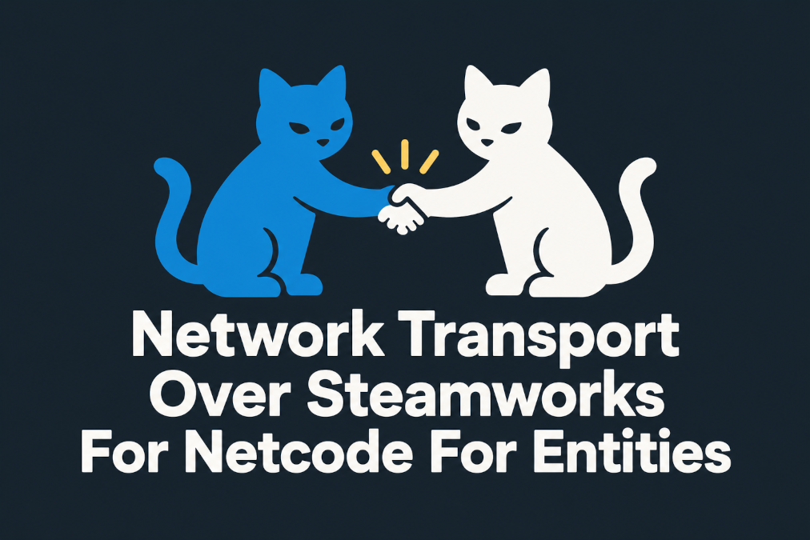

# Network Transport Over Steamworks For Netcode For Entities



Network transport for Unity **[Netcode for Entities](https://docs.unity3d.com/Packages/com.unity.netcode@latest/)** implemented using Steamworks SDK (`ISteamNetworkingSockets`).

- Created specifically for use with **Netcode for Entities**.

- Tested with [Steamworks.NET](https://github.com/rlabrecque/steamworks.net).

- Supports **P2P**, **Fake IP**, and **real IP** connections. Servers/hosts can have all three types of listen sockets at the same time.

- Conversion between Steamworks messages <-> Unity Transport packets is done via **bursted jobs**.

****This package only handles the data transfer over Steamworks.  It doesn't initialize Steamworks, doesn't initialize Netcode for Entities, doesn't handle matchmaking, doesn't initiate connections, doesn't start sockets etc.**

**It also doesn't bundle the Steamworks SDK DLL.**


## Installation

- Open the Unity Package Manager.
- Click the `+` button and select `Add package from git URL...`
- Enter the following URL: 
  ```
  https://github.com/vklubkov/UnityNetworkTransportOverSteamworks.git
  ```
  Or, if you want to use SSH: 
  ```
  git@github.com:vklubkov/UnityNetworkTransportOverSteamworks.git
  ```


## Getting started

This example shows how you can set up the host (the client-hosted server) and the client.

### Host

```csharp
// 1. Init Steamworks
// 2. (Optional) init relay network

// 3.
var sockets = SteamNetworkDriverConstructor.GetSteamUserSockets();

SteamNetworkDriverConstructor.InitializeClientAndServer(
    sockets,
    SteamNetworkInterfaceType.IP,
    SteamNetworkInterfaceTypeFlags.IP | SteamNetworkInterfaceTypeFlags.P2P);

// 4. Create client and server worlds
// 5. Load the networked scene into the worlds
// 6. Create listen sockets, poll groups, and client conneciton via Steamworks

// 7.
SteamNetworkEndpoint.CreateForListenSockets(
    out var serverEndpoint,
    SteamNetworkInterfaceTypeFlags.IP | SteamNetworkInterfaceTypeFlags.P2P,
    listenSocketP2P, pollGroupP2P,
    listenSocketIP, pollGroupIP);

// 8.
SteamNetworkEndpoint.CreateForConnection(
    out var clientEndpoint,
    SteamNetworkInterfaceTypeFlags.IP,
    clientConnection);

// 9. Use `NetworkStreamDriver.Listen(serverEndpoint)` in server world
// 10. Use `NetworkStreamDriver.Connect(clientEndpoint)` in client world
```

### Client

Note: for testing P2P clients, you need multiple machines running the Steam app with different Steam users. But for local testing in Unity Editor, via `Window -> Multiplayer -> Multiplayer Play Mode`, you can use IP-based clients.

```csharp
// 1. Init Steamworks
// 2. (Optional) init relay network

// 3.
var sockets = SteamNetworkDriverConstructor.GetSteamUserSockets();

// 4.
SteamNetworkDriverConstructor.InitializeClient(
    sockets, 
    SteamNetworkInterfaceType.P2P);

// 5. Create client world
// 6. Load the networked scene into the world
// 7. Create client conneciton via Steamworks

// 8.
SteamNetworkEndpoint.CreateForConnection(
    out var clientEndpoint,
    SteamNetworkInterfaceTypeFlags.P2P,
    clientConnection);

// 9. Use `NetworkStreamDriver.Connect(clientEndpoint)` in client world
```

Disconnect should be handled through Steamworks and Netcode for Entities, Network Transport Over Steamworks is not involved.

When you want to reset the drivers in Netcode for Entities, you can do so using `SteamNetworkDriverConstructor.Deinitialize();`

*Not related to Network Transport Over Steamworks itself, but I shoudl probably mention that properly disconnecting from Steamworks could be improtant. I experienced a crash in Unity Editor on Linux when I didn't diconnect before deinitializing Steamworks, which worked just fine on Windows.*


## Documentation

### SteamNetworkDriverConstructor class

```csharp
/// Returns the pointer to the Steamworks sockets.
/// Use this one where you want to get the sockets
/// for a Steam user (tied to the running Steam app).
static IntPtr GetSteamUserSockets()
    
/// Returns the pointer to the Steamworks sockets.
/// Use this one where you want to get the sockets for
/// Steamworks game server (not tied to the Steam app).    
static IntPtr GetSteamGameServerSockets()    
```
Return the pointer to the native Steamworks sockets (`ISteamNetworkingSockets`). These methods are exposed to let you decide which sockets to use, instead of guessing internally. Should only be called after `SteamAPI.Init()/GameServer.Init()` succeeded.
Return `IntPtr.Zero` in case of errors.

```csharp
/// Sets SteamNetworkDriverConstructor as the driver constructor in
/// Netcode for Entities, so any new client drivers created after this call will 
/// use Steamworks, and creation of any new server drivers will fail.
/// Also updates the drivers of the existing worlds, but only
/// if they are specified in the worlds parameter.
/// The client interface type is set via clientInterface.
/// sockets require the sockets returned from
/// GetSteamUserSockets or GetSteamGameServerSockets.
/// You can also specify the Steamworks send flags via sendFlags and
/// how many Steamworks messages are processed per frame via messagesPerReceive.
/// Returns false in case of errors, and you can assume
/// that in this case the driver constructor was not set.
/// Errors while updating the drivers of the existing worlds are
/// reported to the console but don't cause this method to return false.
static bool InitializeClient(
    IntPtr sockets,
    SteamNetworkInterfaceType clientInterface,
    SteamSendFlags sendFlags = Defaults.SendFlags,
    int messagesPerReceive = Defaults.MessagesPerReceive,
    List<World> worlds = null)
    
/// Sets SteamNetworkDriverConstructor as the driver constructor in
/// Netcode for Entities, so any new server drivers created after this call will
/// use Steamworks, and creation of any new client drivers will fail.
/// Also updates the drivers of the existing worlds, but only
/// if they are specified in the worlds parameter.
/// The server interface types are set via serverInterfaces.
/// sockets require the sockets returned from
/// GetSteamUserSockets or GetSteamGameServerSockets.
/// You can also specify the Steamworks send flags via sendFlags and
/// how many Steamworks messages are processed per frame via messagesPerReceive.
/// Returns false in case of errors, and you can assume
/// that in this case the driver constructor was not set.
/// Errors while updating the drivers of the existing worlds are
/// reported to the console but don't cause this method to return false.
static bool InitializeServer(
    IntPtr sockets,
    SteamNetworkInterfaceTypeFlags serverInterfaces,
    SteamSendFlags sendFlags = Defaults.SendFlags,
    int messagesPerReceive = Defaults.MessagesPerReceive,
    List<World> worlds = null)
            
/// Sets SteamNetworkDriverConstructor as the driver constructor in
/// Netcode for Entities, so any new drivers created after this call will use Steamworks.
/// Also updates the drivers of the existing worlds, but only
/// if they are specified in the worlds parameter.
/// The client interface type is set via clientInterface.
/// The server interface types are set via serverInterfaces.
/// sockets require the sockets returned from
/// GetSteamUserSockets or GetSteamGameServerSockets.
/// You can also specify the Steamworks send flags via sendFlags and
/// how many Steamworks messages are processed per frame via messagesPerReceive.
/// Returns false in case of errors, and you can assume
/// that in this case the driver constructor was not set.
/// Errors while updating the drivers of the existing worlds are
/// reported to the console but don't cause this method to return false.
static bool InitializeClientAndServer(
    IntPtr sockets,
    SteamNetworkInterfaceType clientInterface,
    SteamNetworkInterfaceTypeFlags serverInterfaces,
    SteamSendFlags sendFlags = Defaults.SendFlags,
    int messagesPerReceive = Defaults.MessagesPerReceive,
    List<World> worlds = null)      

/// Resets the driver constructor in Netcode for Entities, so any new
/// drivers created after this call use the default Netcode constructor.
/// Also updates the drivers of the existing worlds, but only if they
/// are specified in the `worlds` parameter. Errors while updating
/// the drivers of the existing worlds are reported to the console.    
static bool Deinitialize(List<World> worlds = null)
```

Other methods of SteamNetworkDriverConstructor are automatically called by Netcode for Entities.


### SteamNetworkInterfaceType enum

```csharp
public enum SteamNetworkInterfaceType {
    None = 0,
    P2P = 1,
    IP = 2,
    FakeIP = 3
}
```
Allows you to specify the network interface type for clients.


### SteamNetworkInterfaceTypeFlags enum

```csharp
[Flags]
public enum SteamNetworkInterfaceTypeFlags {
    None = 0,
    P2P = 1,
    IP = 2,
    FakeIP = 4
}
```
Same as `SteamNetworkInterfaceType`, but flags, allowing you to specify multiple types of network interfaces for servers.


### SteamSendFlags enum

```csharp
[Flags]
public enum SteamSendFlags {
    Unreliable = 0,
    NoNagle = 1,
    UnreliableNoNagle = Unreliable | NoNagle,
    NoDelay = 4,
    UnreliableNoDelay = Unreliable | NoDelay | NoNagle,
    Reliable = 8,
    ReliableNoNagle = Reliable | NoNagle,
    UseCurrentThread = 16,
    AutoRestartBrokenSession = 32
}
```
An enum representing the send flags as described in the Steamworks SDK documentation for [steamnetworkingtypes.h](https://partner.steamgames.com/doc/api/steamnetworkingtypes) and [SendMessageToConnection](https://partner.steamgames.com/doc/api/ISteamNetworkingSockets#SendMessageToConnection).


### SteamNetworkEndpoint class

A set of methods that help populate and read custom Steamworks socket and connection data from the `NetworkEndpoint`.

```csharp
/// Creates a new NetworkEndpoint with the provided interface
/// type, connection, poll group, and NetworkEndpoint.Family
/// set to NetworkFamily.Custom. The caller must ensure the parameters
/// hold the appropriate connection data  before calling this method.
static void CreateForConnection(
    out NetworkEndpoint endpoint,
    SteamNetworkInterfaceType type = SteamNetworkInterfaceType.None,
    uint connection = 0, 
    uint pollGroup = 0)
    
/// Creates a new NetworkEndpoint with the provided interface
/// types, listen sockets, poll groups, and NetworkEndpoint.Family
/// set to NetworkFamily.Custom. The caller must ensure the parameters
/// hold the appropriate listen sockets data  before calling this method.
static void CreateForListenSockets(
    out NetworkEndpoint endpoint,
    SteamNetworkInterfaceTypeFlags types = SteamNetworkInterfaceTypeFlags.None,
    uint listenSocketP2P = 0,
    uint pollGroupP2P = 0,
    uint listenSocketIP = 0,
    uint pollGroupIP = 0,
    uint listenSocketFakeIP = 0, 
    uint pollGroupFakeIP = 0)
    
/// Fills the specified NetworkEndpoint with the provided interface
/// type, connection, poll group, and NetworkEndpoint.Family
/// set to NetworkFamily.Custom. The caller must ensure the parameters
/// hold the appropriate connection data  before calling this method.
static void SetSteamConnection(
    this ref NetworkEndpoint endpoint,
    SteamNetworkInterfaceType type = SteamNetworkInterfaceType.None,
    uint connection = 0, 
    uint pollGroup = 0)

/// Fills the specified NetworkEndpoint with the provided interface
/// types, listen sockets, poll groups, and NetworkEndpoint.Family
/// set to NetworkFamily.Custom. The caller must ensure the parameters
/// hold the appropriate listen sockets data  before calling this method.
static void SetSteamListenSockets(
    this ref NetworkEndpoint endpoint,
    SteamNetworkInterfaceTypeFlags types = SteamNetworkInterfaceTypeFlags.None,
    uint listenSocketP2P = 0,
    uint pollGroupP2P = 0,
    uint listenSocketIP = 0, 
    uint pollGroupIP = 0,
    uint listenSocketFakeIP = 0, 
    uint pollGroupFakeIP = 0)

/// Gets the interface type, connection, and poll group
/// from the specified NetworkEndpoint.
/// The caller must ensure the NetworkEndpoint holds
/// the appropriate connection data before calling this method.
static void GetSteamConnection(
    this ref NetworkEndpoint endpoint,
    out SteamNetworkInterfaceType type,
    out uint connection, 
    out uint pollGroup)

    
/// Gets the interface types, listen sockets, and poll groups
/// from the specified NetworkEndpoint.
/// The caller must ensure the NetworkEndpoint holds
/// the appropriate listen sockets data before calling this method.
static void GetSteamListenSockets(
   this in NetworkEndpoint endpoint,
   out SteamNetworkInterfaceTypeFlags types,
   out uint listenSocketP2P, 
   out uint pollGroupP2P,
   out uint listenSocketIP, 
   out uint pollGroupIP,
   out uint listenSocketFakeIP, 
   out uint pollGroupFakeIP)
```


### SteamNetworkInterface struct

The actual interface used by Unity Transport to streamline the messages through Steamworks. You don't have to interact with it directly. 

It is only made public to enable custom setups without the use of `SteamNetworkDriverConstructor`. In which case you are only interested in its constructors, other methods class are automatically called by Unity Transport.

```csharp
SteamNetworkInterface(
    bool isServer, 
    IntPtr sockets, 
    SteamNetworkInterfaceType interfaceType, 
    SteamSendFlags sendFlags = Defaults.SendFlags, 
    int messagesPerReceive = Defaults.MessagesPerReceive)
```
Use this constructor when Netcode for Entities is not installed or when you don't want to use its `NetDebug`. `isServer` should be set to `true` if the interface is used for a server (**including client-hosted servers**), and to `false` if it is used for a client. Other parameters are similar to `SteamNetworkDriverConstructor.Initialize...` methods.

```csharp
SteamNetworkInterface(
    in NetDebug netDebug, 
    bool isServer, 
    IntPtr sockets, 
    SteamNetworkInterfaceType interfaceType, 
    SteamSendFlags sendFlags = Defaults.SendFlags,
    int messagesPerReceive = Defaults.MessagesPerReceive)
```
Use this constructor when Netcode for Entities is installed and you want to use its `NetDebug`. `isServer` should be set to `true` if the interface is used for a server (**including client-hosted servers**), and to `false` if it is used for a client. Other parameters are similar to `SteamNetworkDriverConstructor.Initialize...` methods.


### NetDebug struct

A stub for the `NetDebug` struct used when Netcode for Entities is not installed. It has to be public due to its presence in the `SteamNetworkInterface` constructor. You don't have to interact with it in any way.


### Debugging and optimization

| Name                                                  | Description                                                                                                                                                                                                                                                         | 
|-------------------------------------------------------|---------------------------------------------------------------------------------------------------------------------------------------------------------------------------------------------------------------------------------------------------------------------|
| `NETWORK_TRANSPORT_OVER_STEAMWORKS_DISABLE_LOGGING`   | Disables logging (and tracing, if enabled) in Network Transport Over Steamworks.                                                                                                                                                                                    |
| `NETWORK_TRANSPORT_OVER_STEAMWORKS_ENABLE_TRACING`    | Enables tracing in Network Transport Over Steamworks. To see the tracing logs, you should go to `Window -> Multiplayer -> Play Mode Tools`, enable `Force Log Settings` and select the `Debug` log level. For builds, you can enable the needed log level via code. |
| `NETWORK_TRANSPORT_OVER_STEAMWORKS_DISABLE_RICH_LOGS` | Disables the Rich Text tags in Network Transport Over Steamworks log messages. This only affects Editor, as Rich Text is disabled in builds.                                                                                                                      |

There are some collection checks under `ENABLE_UNITY_COLLECTIONS_CHECKS` in both bursted and not bursted code. These checks will likely not be present in release builds.


## Known issues and limitations

- Network Transport Over Steamworks doesn't check whether SteamAPI/GameServer, Relay Network, or anything else is initialized and available. It always calls into native functions, as Steamworks SDK promises to handle this. If that's not enough, you can handle this manually at a higher level.


- Send/Receive jobs that do Steam <-> Netcode message conversion aren't parallelized. Processing received messages in parallel seems doable, but for sending, the previous job should be synchronized (otherwise, I found no way to get the number of Netcode packets in the queue), which makes it not worth it. All other implementations of `INetworkInterace` I've seen so far also run their jobs synchronously.


- The `NetworkEndpoint` for listen sockets is composite, so you start all listen sockets in a single `Listen` call. This is due to how Netcode for Entities handles listening: it loops over all existing drivers, and if a driver is already listening, it throws an exception. 


- Not integrated with **[Netcode for GameObjects](https://docs.unity3d.com/Packages/com.unity.netcode.gameobjects@latest/)**. While both Netcode for Entities and Netcode for GameObjects support custom Network Interfaces, Netcode for GameObjects integration requires subclassing `NetworkTransport` for a higher level interaction with Steamworks. I made the `SteamNetworkInterface` public, so you can try to implement it yourself. But I am not sure whether it is worth doing this, as there are some other Steamworks integrations for Netcode for GameObjects available, including [this](https://github.com/Unity-Technologies/multiplayer-community-contributions/tree/main/Transports/com.community.netcode.transport.steamnetworkingsockets) and [this](https://github.com/Unity-Technologies/multiplayer-community-contributions/tree/main/Transports/com.community.netcode.transport.facepunch).


- Sockets interface version is hardcoded in *SteamAPI.cs*, and I need to update this version whenever the native Steamworks library upgrades the sockets interface. This is a limitation of Steamworks SDK. Steamworks.NET has the same issue. In case you need to do this yourself, you can copy the package to *Packages* folder (Unity Package Manager has the `Customize` option hidden in a dropdown, which does exactly this), find *Runtime/NetworkTransportOverSteamworks/Internal/NativeAPI/SteamAPI.cs*, then `NetworkTransportOverSteamworks.SteamAPI.SocketsVersion` inside of it, and change the version. This should work for as long as the actual Steamworks APIs used by Network Transport Over Steamworks remain unchanged.


## AI use disclosure

The initial prototype was implemented by AI. It was then fully rewritten manually, except that I did few AI requests that resulted in some minor code changes. I extensively consulted with AI to get a better understanding of Steamworks SDK and how it can be integrated with Netcode for Entities. Logo was generated with AI. Few documentation comments were improved with AI. AI autocompletion was enabled in the IDE. 


## License

[MIT](LICENSE.md)

```
MIT License

Copyright (c) 2026 Vladimir Klubkov

Permission is hereby granted, free of charge, to any person obtaining a copy
of this software and associated documentation files (the "Software"), to deal
in the Software without restriction, including without limitation the rights
to use, copy, modify, merge, publish, distribute, sublicense, and/or sell
copies of the Software, and to permit persons to whom the Software is
furnished to do so, subject to the following conditions:

The above copyright notice and this permission notice shall be included in all
copies or substantial portions of the Software.

THE SOFTWARE IS PROVIDED "AS IS", WITHOUT WARRANTY OF ANY KIND, EXPRESS OR
IMPLIED, INCLUDING BUT NOT LIMITED TO THE WARRANTIES OF MERCHANTABILITY,
FITNESS FOR A PARTICULAR PURPOSE AND NONINFRINGEMENT. IN NO EVENT SHALL THE
AUTHORS OR COPYRIGHT HOLDERS BE LIABLE FOR ANY CLAIM, DAMAGES OR OTHER
LIABILITY, WHETHER IN AN ACTION OF CONTRACT, TORT OR OTHERWISE, ARISING FROM,
OUT OF OR IN CONNECTION WITH THE SOFTWARE OR THE USE OR OTHER DEALINGS IN THE
SOFTWARE.
```

The platform define guard in the begining of each source file was copied from [Steamworks.NET](https://github.com/rlabrecque/steamworks.net). Steamworks.NET is distributed under the [MIT](Third%20Party%20Notices.md) license:

```
The MIT License (MIT)

Copyright (c) 2013-2022 Riley Labrecque

Permission is hereby granted, free of charge, to any person obtaining a copy
of this software and associated documentation files (the "Software"), to deal
in the Software without restriction, including without limitation the rights
to use, copy, modify, merge, publish, distribute, sublicense, and/or sell
copies of the Software, and to permit persons to whom the Software is
furnished to do so, subject to the following conditions:

The above copyright notice and this permission notice shall be included in
all copies or substantial portions of the Software.

THE SOFTWARE IS PROVIDED "AS IS", WITHOUT WARRANTY OF ANY KIND, EXPRESS OR
IMPLIED, INCLUDING BUT NOT LIMITED TO THE WARRANTIES OF MERCHANTABILITY,
FITNESS FOR A PARTICULAR PURPOSE AND NONINFRINGEMENT. IN NO EVENT SHALL THE
AUTHORS OR COPYRIGHT HOLDERS BE LIABLE FOR ANY CLAIM, DAMAGES OR OTHER
LIABILITY, WHETHER IN AN ACTION OF CONTRACT, TORT OR OTHERWISE, ARISING FROM,
OUT OF OR IN CONNECTION WITH THE SOFTWARE OR THE USE OR OTHER DEALINGS IN
THE SOFTWARE.
```
